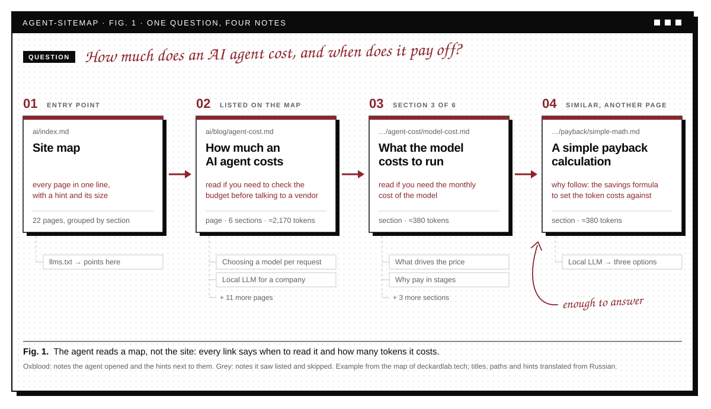

<p align="center">
  
</p>

<h1 align="center">agent-sitemap</h1>

<p align="center">
  <b>Turns your website into a linked Markdown map that AI agents can walk,<br>opening only the pages they need.</b>
</p>

<p align="center">
  <a href="#quick-start">Quick start</a> ·
  <a href="#what-an-agent-reads">What an agent reads</a> ·
  <a href="#how-the-links-are-made">How the links are made</a> ·
  <a href="#publish-the-map">Publish the map</a> ·
  <a href="#hints-from-a-model">Hints from a model</a> ·
  <a href="#for-ai-agents">For AI agents</a>
</p>

---

An agent that lands on a website has two poor choices: read whole pages and fill its context,
or guess from titles and miss. `agent-sitemap` gives it a third one. It cuts the site into small
notes, one per page and one per section, and links them the way an Obsidian vault is linked.
Every link says what is behind it and how many tokens it costs, so the agent reads a short note,
picks the next step and goes deeper only where the question needs it.

The map is plain Markdown with absolute links. Any agent that can fetch a URL can walk it; it
needs no SDK, no plugin and no server-side search.

## Quick start

In your site's repository:

```bash
pnpm add -D agent-sitemap
pnpm agent-sitemap
```

The first run sets everything up by asking three questions; later runs only rebuild the map.

<table><tr><td>

### Onboarding: the first run, step by step

**Before you start.** Run it from the root of the site's repository, with Node 20.17 or newer. If
some pages are built by a framework (Astro, Next export, Vite prerender…), build the site first:
the map reads them from the build folder.

**Step 1 of 3 · Site address.** The address found in `robots.txt`, `sitemap.xml`, `CNAME` or
`package.json` is filled in.
- Enter accepts it; type another address to change it.
- No site online yet? Leave it empty: links inside the map become relative.

**Step 2 of 3 · Pages.** You see what goes into the map: the build folder, groups of Markdown
pages with the URLs they get (`blog/*/post.md → /blog/*/`), the folder the map is written to and
the `llms.txt` that will point to it.
- Enter (or `y`) builds the map from them.
- `n` stops without saving: edit `agent-sitemap.config.json` by hand and run again.

**Step 3 of 3 · Hints from a model.** Choose with ↑ ↓ and Enter who writes the «read if…» and
«why follow» hints next to the links:

- **No model**: free. Hints are the first sentence of each note; the same map on every run.
- **Claude Code, Codex**: your subscription. Shown when installed; if not signed in, choosing one
  opens its sign-in (`claude auth login`, `codex login`) right there.
- **DeepSeek, Kimi, OpenRouter**: paid per request. The token is asked once and kept in
  `~/.config/agent-sitemap/`, never in the repository.
- **Claude API**: paid per request. Shown when `ANTHROPIC_API_KEY` is set.

**Then** the map is built: a progress bar runs while the model writes the hints, and the build
ends with what to do next.
- Commit the map folder (e.g. `public/ai/`), `llms.txt` and `agent-sitemap.config.json`, and
  deploy as usual. The map opens at `https://your-site/ai/index.md`.
- `.agent-sitemap-cache.json` holds the model's answers: commit it to save requests on other
  machines, or add it to `.gitignore`.

**Next runs** ask nothing: `pnpm agent-sitemap` rebuilds the map from the saved settings and
rewrites only what changed. `pnpm agent-sitemap init` asks the questions again. In CI, or with
`--yes`, the answers found are taken without asking.

</td></tr></table>

A first run in the repository of [deckardlab.tech](https://deckardlab.tech), abridged (while
the model writes the hints, a progress bar runs under «Annotating»):

```text
1/3  Site address  links in the map point under it
     found https://deckardlab.tech/ in apps/web/public/robots.txt
     Site address (https://deckardlab.tech/)

2/3  Pages
     built pages in apps/web/dist
     13 Markdown pages blog/*/post.md → /blog/*/
     the map goes to apps/web/public/ai, served with the site from apps/web/public
     apps/web/public/llms.txt gets one line pointing to the map
     Build the map from these? Yes

3/3  Hints from a model  «read if…» next to every note, «why follow» next to every link
     Who writes the hints? Claude Code, under your subscription

Saved to agent-sitemap.config.json: edit it to change what goes into the map.

Reading apps/web/dist, blog/*/post.md

From https://deckardlab.tech: 1 page is on the site but not in the repository
  markdown  https://deckardlab.tech/blog/

Annotating 22 pages with the claude CLI

Map: 167 notes in ./apps/web/public/ai (168 written, 0 unchanged, 0 removed)
  added a line pointing to the map to ./apps/web/public/llms.txt

Commit ./apps/web/public/ai and llms.txt and deploy with the site: the map opens at https://deckardlab.tech/ai/index.md
```

### Where the pages come from

The first run looks at the repository for:

- **the site's address**, from `robots.txt`, `sitemap.xml` or `CNAME` in the static folder, or
  `homepage` in `package.json`;
- **the pages**: the built site (`dist`, `build`, `out` or `_site`) and Markdown files with a
  `title` in their front matter (`blog/*/post.md` → `/blog/*/`, `src/content/blog/*.md` → `/blog/*/`);
- **the folder the site serves as is** (`public` or `static`), where the map goes as `ai/`;
- **`llms.txt`** in that folder, which gets one line pointing to the map.

Then it compares the result with the live site's `sitemap.xml`: pages that are on the site but in
no file of the repository (posts published from another machine, pages a server renders) are read
from the site, as Markdown when it offers it. Only those are fetched; a site out of reach leaves
the map to the repository. `--offline`, or `"fromSite": false` in the settings, skips this.

A rebuild rewrites only the notes whose content changed and deletes the notes of pages that are
gone, so the diff shows exactly what changed.

### The settings file

```json
{
  "site": "https://example.com/",
  "out": "public/ai",
  "from": ["dist", "content/blog/*.md=/blog/*/"],
  "exclude": ["/privacy"],
  "llmsTxt": "public/llms.txt",
  "llm": "claude"
}
```

`llm` is `none`, `claude`, `codex`, `api`, `deepseek`, `kimi` or `openrouter`. When the chosen
one is not available on a machine (not installed, not signed in, no token), the map is built
without hints and the build says so once.

`site` only sets the address the links point to. Each entry of `from` is one of:

| `from` | Reads | URL of a page |
| --- | --- | --- |
| `dist` | every `.md` and `.html` in a folder: a built site | from the path: `dist/a/index.html` → `/a/`, `dist/a/b.md` → `/a/b` |
| `content/**/*.md` | the files a glob matches (`*` within a folder, `**` across folders) | from the path after the glob's fixed part |
| `blog/*/post.md=/blog/*/` | the same, with the URL given | each `*` in the URL takes what the `*` in the path matched |

From Markdown front matter it takes `title` and `description` (the author's summary is used
as is) and skips pages that are not public: `draft: true`, `status: draft` (also `private`,
`hidden`, `unpublished`, `archived`, `scheduled`), `noindex: true`, and a `publishAt` or
`publishDate` in the future. When a page exists both as `.html` and `.md`, the Markdown wins.
Built pages with next to no text (search-console verification files) and the map's own copy in
the build are skipped.

`fromSite` (on when `site` is set) fills in from the live site what the files do not have.
`agent-sitemap init` asks the questions again and rewrites the file.

### Any site, from the web

Without a repository, give the address. The map is built from the live site, through its
`sitemap.xml`:

```bash
npx agent-sitemap https://example.com
```

It writes the map to `./ai`, and prints where to upload it and the line for `llms.txt`.

## For AI agents

Instructions for a coding agent (Claude Code, Codex, Cursor and the like) asked to set up or
update the map of a site. Copy them into the repository's `AGENTS.md` or `CLAUDE.md` if the agent
should keep the map up to date on its own.

**Set it up**

1. In the root of the site's repository: `pnpm add -D agent-sitemap` (or `npm i -D`).
2. If some pages come from a framework build, build the site first (`pnpm build`).
3. Run `pnpm agent-sitemap --yes`. Without a terminal there are no questions: the address, the
   pages and the output folder are taken as found and saved to `agent-sitemap.config.json`.
4. Read the output. Lines marked `missing` say what could not be found: put it in
   `agent-sitemap.config.json` (`site`, `from`, `out`, see [the settings file](#the-settings-file))
   and run again. Check that every `from` pattern maps files to the URLs they have on the live site.
5. Check the map: `pnpm agent-sitemap check <out>` must report `0 problems` (exit code 0).
6. Commit the map folder, `llms.txt` and `agent-sitemap.config.json`.

**Hints from a model.** They cost the user money or subscription limits, so do not turn them on
by yourself: ask first. With the user's consent, set `"llm"` in the settings (`claude`, `codex`,
`deepseek`, `kimi`, `openrouter` or `api`). Never write a token into the repository or the
settings: tokens come from environment variables (`DEEPSEEK_API_KEY`, `MOONSHOT_API_KEY`,
`OPENROUTER_API_KEY`, `ANTHROPIC_API_KEY`) or from the user's own first run in a terminal. If the
build says an agent is not signed in, pass the command it names to the user.

**Keep it up to date.** After changing pages or posts, run `pnpm agent-sitemap` again and commit
the changes in the map folder together with the content. Only notes whose content changed are
rewritten, so the diff is small. Do not edit files in the map folder by hand: the next build
overwrites them; change the settings or the content instead.

**Read a map.** To answer a question about a site that has one, start at `/ai/index.md` (or the
map linked from its `llms.txt`). Each link says when to read the note and how many tokens it
costs: open the page that fits the question, then only the sections you need, and follow
«Where next» for related sections on other pages. Each note links back to the original page.

A short version for `AGENTS.md`:

```markdown
## Site map for AI agents

The map of this site for AI agents lives in `public/ai/` and is built by agent-sitemap
(settings: `agent-sitemap.config.json`). After changing pages or posts, run
`pnpm agent-sitemap`, check with `pnpm agent-sitemap check public/ai` and commit the map with
the change. Do not edit the map by hand, and do not turn on hints from a model without asking.
```

## What an agent reads

The map has three levels:

| Note | What it holds |
| --- | --- |
| `index.md` | The entry point: every page in one line, grouped by section of the site, with a summary, the number of sections and the size in tokens. |
| `<page>.md` | The page's summary and intro, its sections, the pages it links to, the pages that link to it, and similar pages. |
| `<page>/<section>.md` | The full text of one section (split on `##`), then **Where next**: the next section, links from the text and similar sections on other pages. |

A section note, as an agent sees it:

```markdown
---
type: Web Page Section
title: What the model costs to run
description: "Cloud models charge for the text they read and write, measured in tokens."
resource: "https://example.com/blog/agent-cost/"
page: "https://example.com/ai/blog/agent-cost.md"
tokens: 60
---

# What the model costs to run

Section 2 of 3 of [How much an AI agent costs](https://example.com/ai/blog/agent-cost.md) · ≈60 tokens

Cloud models charge for the text they read and write, measured in tokens. Monthly cost = …

## Where next

- Next section: [Why pay in stages](https://example.com/ai/blog/agent-cost/why-pay-in-stages.md) — A fixed price for a turnkey agent before the vendor has seen your data is a warning sign. · ≈50 tokens
- Similar on other pages:
  - [Will an AI agent pay off? → A simple payback calculation](https://example.com/ai/blog/payback/a-simple-payback-calculation.md) — Monthly saving = operations × (minutes now − minutes with the agent) ÷ 60 × hourly cost. · ≈40 tokens
```

Labels follow the language of the site (Russian and English for now; `--lang` overrides it).
Next to the notes, `graph.json` holds the same nodes and typed edges for tools.

## How the links are made

The base build uses no language model and gives the same map for the same site.

| Edge | Source |
| --- | --- |
| `contains` | a page → its sections |
| `next` | a section → the section that follows it |
| `links` | a same-site link written in the section text |
| `lists` | a listing page, such as a blog index, → the pages it lists as `## [Title](/url)` cards |
| `related` | similar content on another page: TF-IDF cosine over stemmed words, at most one section per page |

Sections whose heading repeats across the site (on 3 pages or more, and on at least a quarter
of them) are template parts such as “More from the blog” or a call to action. The build drops
them, and the cards inside them.

Pages are read as Markdown when the site offers it, and converted from HTML otherwise:

1. `Accept: text/markdown`
2. `<link rel="alternate" type="text/markdown">`
3. the page's `<main>`, converted with Turndown

## Publish the map

1. **Upload** `./ai` so that `https://example.com/ai/index.md` opens. To serve it elsewhere,
   build with `--base <url>`.
2. **Point agents at it.** Agents do not look for maps on their own, so add a line to
   `llms.txt`. The build prints it, in the language of the site:

   ```markdown
   - [Site map for AI agents](https://example.com/ai/index.md): linked notes for every page and section, with their size in tokens
   ```

3. **Rebuild** when the site changes, for example after each deploy.
4. **Check** the map at any time. `check` exits with code 1 on problems, so it fits CI:

   ```bash
   npx agent-sitemap check ./ai
   # 115 notes, 901 links between them: 0 problems, 0 warnings — a valid OKF 0.2 map
   ```

The build deletes notes of pages that are gone from `--out`, so it refuses to write into a
folder that is not an earlier map.

## Hints from a model

```bash
pnpm agent-sitemap --llm
```

Without a model, the text next to a link is the first sentence of the target. With `--llm`, the
build sends one request per page, with the page's sections and the links that leave it. It
reaches a model in one of these ways (`--llm-with`):

| `--llm-with` | Model | You need |
| --- | --- | --- |
| `claude` | [Claude Code](https://claude.com/claude-code) on this machine (`claude -p`), its default model | `claude` installed and signed in |
| `codex` | [Codex](https://github.com/openai/codex) on this machine (`codex exec`), its default model | `codex` installed and signed in |
| `api` | the Claude API, `claude-opus-5-5` | `ANTHROPIC_API_KEY` |
| `deepseek` | the DeepSeek API, `deepseek-flash` | a token: `DEEPSEEK_API_KEY` |
| `kimi` | the Kimi API (Moonshot), `kimi-k3` | a token: `MOONSHOT_API_KEY` |
| `openrouter` | [OpenRouter](https://openrouter.ai), `deepseek/deepseek-v4.1-flash`; any of its models with `--model` | a token: `OPENROUTER_API_KEY` |

Address and model are built in; `--model` picks another. A token comes from its environment
variable or is entered once during the first run: it is then kept in
`~/.config/agent-sitemap/credentials.json`, readable by you only, never in the repository.
Without `--llm-with`, the build uses the model chosen on the first run; with `--llm` alone, the
first one available: the Claude API with a key, an installed agent, a provider with a token.
Claude Code runs with no tools and Codex in a read-only sandbox, in a temporary folder: they read
the page they are given and answer with the same JSON schema as the APIs. The model writes:

- **when to read** each page and section, shown next to every link to it:
  “read if you need to estimate the monthly budget”;
- **why follow** each link: what the target adds for a reader of this note;
- **a factual summary** for each note;
- **which similarity links to drop**: those that only share words. Links written by the site's
  authors are always kept.

In a terminal the pass shows a progress bar: `⠹ ▕████████░░░░░░░░▏ 7/21 · 0:42 · blog/price`.

Answers are cached in `.agent-sitemap-cache.json` by a hash of each page's content, so a rebuild
pays only for pages that changed. If a request fails, that page keeps its plain annotations and
the build goes on. An agent that is not signed in is caught before the first request: the build
names the command that signs it in (`claude auth login`, `codex login`) and goes on without hints.

## Options

| Option | Default | |
| --- | --- | --- |
| `--offline` | off | build from the repository only, without filling in pages from the live site |
| `--from <files>` | from the settings | read pages from these files; repeatable, see [the settings file](#the-settings-file) |
| `--out <dir>` | from the settings, else `./ai` | where to write the map |
| `--base <url>` | `<site>/ai/` | absolute URL the map is served from |
| `--name <name>` | host name | site name in the map title |
| `--max-pages <n>` | `500` | stop after this many pages from the sitemap |
| `--exclude <path>` | | skip pages under this path; repeatable |
| `--lang <ru\|en>` | detected | language of the map's own labels |
| `--links <style>` | `absolute` | `absolute` URLs for agents on the web, or `relative` paths for a self-contained bundle |
| `--llm` | off | hints from a model, see above |
| `--llm-with <how>` | from the settings | `claude`, `codex`, `api`, `deepseek`, `kimi` or `openrouter` |
| `--model <id>` | per `--llm-with` | another model than the built-in one |
| `-y, --yes` | off | first run: take what was found, ask nothing |
| `--cache <file>` | `.agent-sitemap-cache.json` | where `--llm` keeps its answers |

## Open Knowledge Format

The map is an [Open Knowledge Format](https://github.com/GoogleCloudPlatform/open-knowledge-format)
(OKF v0.2) bundle, so tools that read OKF can open it as is.

- Every note's frontmatter carries the OKF fields `type` (`Web Page` or `Web Page Section`),
  `title`, `description`, `resource` (the page URL) and `generated`, plus this tool's own keys:
  `tokens`, `sections`, `page`, and `when` and `hints_by` after `--llm`.
- `index.md` follows the OKF index format: only `okf_version` in its frontmatter and
  `* [Title](url) - description` entries under headings.
- With `--links relative`, links are paths inside the folder, so OKF tools see the graph and the
  backlinks, and the bundle can live in git. The default absolute URLs suit agents on the web;
  OKF tools read them as external links.

## Status

An early version. On small sites the navigation in each note can cost as much as the text
itself, so the map pays off on larger sites and narrow questions. Next:

- an eval: questions to a site, and the hops and tokens an agent needs with and without the map;
- leaner notes, and token labels that count the whole note, not only its text;
- a GitHub Action that rebuilds the map on every deploy;
- a library API, for building the map from code;
- topic hubs that gather sections across pages.

## Development

The sources are TypeScript that Node 24 runs directly:

```bash
pnpm install
node src/cli.ts https://example.com   # build a map from source
pnpm test                             # tests
pnpm build                            # compile dist/ (runs on npm pack and npm publish)
```

To release, bump `version` in `package.json` and push to `main`. The
[Publish](.github/workflows/publish.yml) workflow runs the tests and publishes the new version to
npm and to GitHub Packages; a push without a new version publishes nothing.

## License

MIT. Made by [Deckard](https://deckardlab.tech), a studio that builds AI agents into company
processes and keeps people in the loop.
